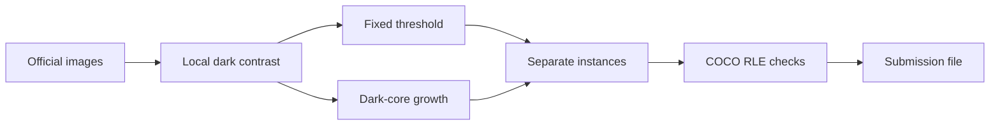
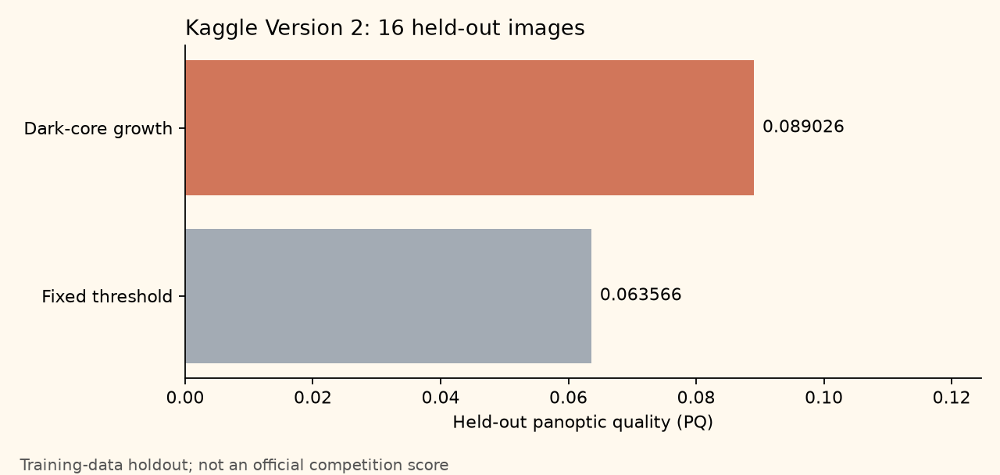
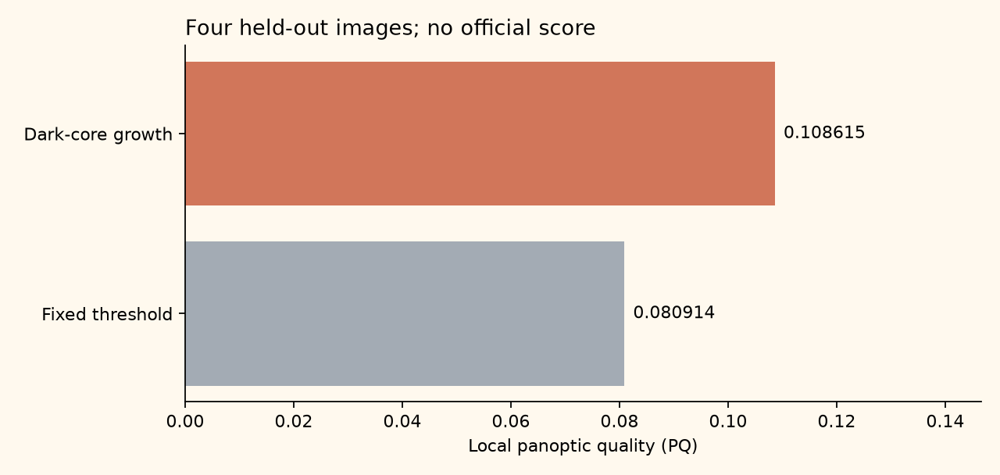

# Solar Threads

An original CPU baseline for the [Filament Segmentation 2026 competition](https://www.kaggle.com/competitions/filament-segmentation-2026).


*Generated decorative illustration. This is not a solar observation.*

Find each dark filament in a solar image. Give each filament its own mask.
This project uses image pixels and the competition's training masks. It adds no outside labels or weights.

**Official public score: 0.08. Submission 57568420 completed on 2026-10-23 and is linked to notebook Version 2.**
The exact submission row and native notebook score badge were verified.
This is a working baseline. No competitive rank is claimed.

Open the [public Kaggle notebook](https://www.kaggle.com/code/prvsiyan/notebook24a4dce69e).
The server assigned this notebook identity. We preserve it exactly.

## What we add

A wide blur estimates local brightness. A small blur reduces image noise.
Their difference finds dark structures on the solar disk.

Our test idea is **dark-core growth**. A faint region survives only if it contains a strong dark core.
This can recover edges and reject weak noise. It can also join nearby filaments.
The fixed-threshold method stays in the test as a control.



## Completed Kaggle run

Version 2 processed all 180 test images and exported 5,316 predicted instance masks.
Its recorded runtime was 375.65 seconds, about 6.26 minutes.
It used the competition data and a CPU baseline.

| Method | Held-out PQ | Images | Annotator records |
|---|---:|---:|---:|
| Fixed threshold | 0.063566 | 16 | 21 |
| Dark-core growth | 0.089026 | 16 | 21 |

These values measure 16 held-out training images. They are not competition test scores.
The selected setting came from 24 calibration images in separate calendar months.
The completed run's notebook cells match the reviewed source exactly.



The [run evidence](evidence/kaggle-v2-run.json) records the notebook identity, version, source hashes, package versions, and submission-file hash.
The [measured table](evidence/kaggle-v2-holdout.csv) supplies the chart.
The output file and competition data are not redistributed here.

## Submission and output checks

The output validator decoded all 5,316 masks across all 180 test images.
The [validation receipt](evidence/kaggle-v2-output-validation.json) records the exact version, source hash, output hashes, and scope.

Submission **57568420** was accepted through Version 2's **Submit to Competition** menu.
Its official status is now `COMPLETE`, with public score **0.08**.
The [score receipt](evidence/official-score-57568420.json) binds the result to the exact version and output hash.
It also records independent verification of the native notebook score badge.
The 0.089026 held-out PQ above remains a training-data measurement.
The earlier [pending observation](evidence/kaggle-v2-submission-status-1749.json) remains in the history.

## Historical local canary

The canary uses four images to select a setting and four images from other months to check it.
No validation image selects the setting. One test image checks the output format.

| Method | Held-out PQ | Images |
|---|---:|---:|
| Fixed threshold | 0.080914 | 4 |
| Dark-core growth | 0.108615 | 4 |

These values come from [saved local measurements](evidence/local-validation.csv).
The [plot script](source/plot_local_results.py) checks each value against the saved canary receipt.



The sample is small. It does not estimate the full test score with useful precision.
The test-image canary produced 50 valid, disjoint instance masks. It was not a complete competition submission.

All seven notebook code cells also ran with explicit bounded input adapters.
That check rendered six plots and kept the canonical notebook unchanged.
See [validation notes](docs/validation.md) for the scope and limits.

## Run the checks

Use Python 3.12 and a new virtual environment.

```sh
python3 -m venv .venv
source .venv/bin/activate
python -m pip install -r requirements.txt
python -m unittest discover -s tests -v
```

The seven public contract tests use synthetic arrays. They need no competition data or credentials.
They check mask encoding, PQ, instance separation, stable month groups, and invalid submission rows.

## Run the notebook

Open `notebook/solar-threads-honest-instance-segmentation.ipynb` in Kaggle.
Join the competition and read its rules. Attach its official data.
Run all cells with a CPU. Keep the saved outputs and their hashes.

The `notebook/` folder preserves the original local draft and its planned identity.
That planned identity was never published. Do not push its `kernel-metadata.json` to Kaggle.
The live identity is `prvsiyan/notebook24a4dce69e`. Read its current server identity before any in-place update.

The full notebook selects a setting on 24 images and checks it on 16 separate images.
It then predicts every image in the current 180-image test release.
The input checks stop if the expected data release changes.

For a future result, submit from the completed notebook version's **Submit to Competition** menu.
Version 2 is already scored. Do not repeat its accepted submission.
Verify the completed submission row and native notebook score badge before claiming an official score.

## Limits and next tests

The method can miss faint filaments and thin edges. It can merge nearby objects.
It does not use a learned representation or pre-trained weights.
Test better instance separation on the same frozen split first.
Then use more months before drawing a strong conclusion.

## Provenance and reuse

- [Host self-evaluation notebook](https://www.kaggle.com/code/azimahmadzadeh/self-evaluation-notebook): public PQ matching rules. We implement them with COCO mask operations.
- [Panoptic Segmentation](https://arxiv.org/abs/1801.00868): the metric's research source.
- [MAGFiLO data paper](https://doi.org/10.1038/s41597-024-03876-y): annotation provenance.
- [Sijan Regmi's public CPU baseline](https://github.com/regmi-sijan/solar-filament-segmentation-2026): independent precedent for local contrast and connected components. No source code or predictions were copied.

Our source code and original prose use the [MIT license](LICENSE).
Competition data and the host notebook are not included. Their own terms apply.
The generated header is decorative. Its [provenance](assets/provenance.json) records the prompt and file hash.
Scientific charts use measured data. The prose uses simple-language guidance, with no ASD-STE100 certification claim.

## Project record

See [CHANGELOG.md](CHANGELOG.md) for real changes and [publication checks](docs/publication.md) for the release boundary.
